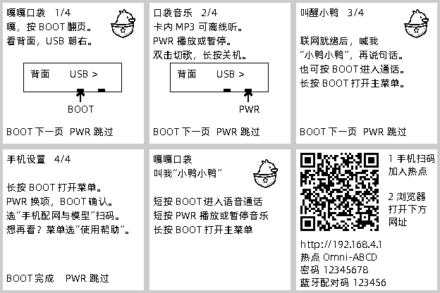
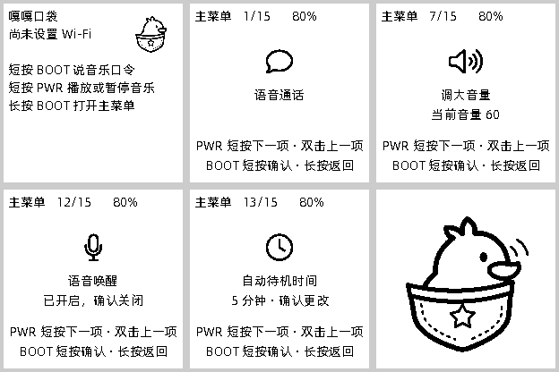

# 嘎嘎口袋 · Quack Pocket

目标设备为微雪 ESP32-S3-ePaper-1.54 SKU 32298（无触控、带锂电池）。当前固件配置对应板背有 V2 标记的 8 MB Flash、8 MB PSRAM 版本。当前开发板已通过 USB 读取芯片标识，确认为 ESP32-S3-PICO-1、8 MB Flash 和 8 MB PSRAM。V1 使用独立示例和引脚定义。

## 构建 V2

在 ESP-IDF 5.5.2 环境中运行。

```sh
./scripts/fetch_waveshare_fonts.sh
idf.py build
idf.py -p /dev/ttyACM0 flash monitor
```

打包发布使用下文的统一命令 `./scripts/release_v2.py`。解压 `releases/omni-epaper-v2.zip` 后，用 `sha256sum -c SHA256SUMS` 校验，在解压目录执行 `esptool.py --chip esp32s3 --port /dev/ttyACM0 write_flash @flash_args`。烧录地址取自本次构建分区表，保留 NVS 所在区域。

固件基线来自微雪官方 `V2-Src-XiaoZhi.zip`，SHA-256 为 `c1b7176786e2481aaebb0a9993f1bd5dd42f0b5d3a850a5e68c40d6acfbc135c`。选择小智服务时，设备通过小智 OTA 服务取得语音服务器信息。自建模式通过手机填写的网关建立对话连接。

## Wi-Fi 固件更新

默认手动检查。可在设备的「设备设置 → 自动检查更新」或网页的「固件更新」中打开自动检查。开启后首次联网时后台检查，连续运行时每 24 小时检查一次。发现新版会短暂提醒，网络或更新服务异常时静默结束。

要检查并安装，在设备主菜单选「设备设置 → 检查更新」。设备从 HTTPS 发布清单读取适用于 V2 的版本，显示当前版本和新版号。短按 BOOT 安装，短按 PWR 取消。同版或更旧的清单只显示当前版本。小智和自建语音网关共用此入口。安装前暂停音乐并结束通话；下载期间保持供电。验签、长度、应用标识和已写入数据的 SHA-256 校验通过后，设备切换至备用应用分区并重启。Wi-Fi 设置、屏保、分区表和独立资源分区保留。

首次使用此菜单，先通过 USB 安装一次含此功能的完整 V2 固件。更新涉及分区表、引导程序或独立资源时也应使用完整包。

### 发布新版本

将根目录 `CMakeLists.txt` 的 `PROJECT_VER` 提升为新的三段数字版本号，然后在仓库根目录运行：

```sh
./scripts/release_v2.py
```

命令编译固件、验证发布密钥并签名，自动将 OTA 镜像和清单放入 `web/ota/`。同时生成 `releases/omni-epaper-v2.zip`（USB）、按版本命名的 OTA 压缩包，以及 `releases/quack-pocket-site.zip`（设置网站和本版固件）。发布私钥默认从 `~/.local/share/quack-pocket/ota-signing.pem` 读取，可通过 `OTA_SIGNING_KEY` 指定备份路径。

默认清单地址为 `https://gaga.omnistreamai.com/ota/manifest.json`。将网站包解压部署到该域名根目录即可。逐文件部署时先上传镜像，再替换清单；二进制文件应返回正确的 `Content-Length`。此前的 2.0.5 和 2.0.6 沿用了固件基线的编号。转入嘎嘎口袋独立的 0.0.6 版本线时，请先用 USB 安装一次；后续 0.0.7 等新版本可通过 OTA 安装。已设置其他更新源的设备会继续使用已保存的地址。

## 首次使用与按键帮助

首次运行时，小鸭先用背面键位图带你找到 BOOT，再介绍卡内音乐、语音唤醒和手机设置。键位图以设备背面、USB 接口朝右为参照，箭头指向当前介绍的键。单击 BOOT 翻页或完成，单击 PWR 跳过。以后长按 BOOT 打开主菜单，单击 PWR 选到「设备设置 → 使用帮助」，再单击 BOOT 重看。



## 部署共享设置页

运行发布命令后，把 `releases/quack-pocket-site.zip` 解压到 HTTPS 站点的同一目录。入口是 `index.html`，固件和清单位于相邻的 `ota/`。通过此网页连接设备，在「固件更新」点「使用本站更新」即可保存本站清单地址，支持将网站放在子目录。以后发版时先上传新镜像，再替换 `ota/manifest.json`。设备仍在自身菜单检查并确认安装。

也可以直接将 [web](web/) 目录中的全部内容上传到 HTTPS 静态站点，例如放到 Nginx 站点目录的 `omni/`。保留图标子目录，并将 `.webmanifest` 作为 `application/manifest+json` 提供。用户打开对应的 `https://你的域名/omni/`，设备开机后点网页上的「选择蓝牙设备」，选择屏幕上同名的 Omni，并在系统配对框输入屏幕上的六位蓝牙配对码。设备启动蓝牙时会生成新的配对码。Android Chrome 支持这条流程。iPhone Safari 用户可扫描设备上的 Wi-Fi 二维码，再打开 `http://192.168.4.1/`。

首次在线打开并完成缓存后，可离线启动设置页。支持安装的浏览器可通过「安装嘎嘎口袋」或浏览器菜单添加到主屏幕，iPhone Safari 可使用分享菜单的「添加到主屏幕」。设备操作仍需连接设备。

同一个 HTML 文件在构建时嵌入固件。设备热点页面直接通过 HTTP 操作，托管页面通过 Web Bluetooth 操作附近设备，Wi-Fi 密码、设备令牌和屏保图片都在浏览器与设备之间传输。两种入口均支持管理 Wi-Fi 列表、语音服务、离线口令、墨水屏屏保以及保存重启和退出。升级已有设备时，使用与托管页面同版本的固件。

### 不用网关的附近设备管理

- **后台设置服务**：首次联网时自动开启。成功读取设备设置后会记住首次管理已完成；当前同网管理页面可继续使用，退出或停止活动约 90 秒后关闭后台监听。之后可在「手机与网络 → 同网扫码管理 → 后台设置服务」手动开关，选择会保留。
- **同一 Wi-Fi**：设备联网后，从主菜单选「手机与网络 → 同网扫码管理」，手机保持连接同一 Wi-Fi，扫描墨水屏上的网址。设备提供 HTTPS，二维码使用每台设备固定的 `quack-xxxxxx.local` 名称，也可手动输入屏幕上的备用 IP 地址。首次访问时浏览器可能提示自签名证书，先将证书 SHA-256 指纹的前 24 位与墨水屏核对。无法查看、信任证书或局域网开启客户端隔离时，可使用设备热点。
- **托管页面蓝牙**：蓝牙默认随设备开机广播，未配网也能连接。可在「手机与网络 → 蓝牙开关」关闭或重新开启，也可在管理网页「设备蓝牙」切换，选择会保存在设备上。访问部署的 HTTPS 网页并选择设备，首次系统配对使用墨水屏上的六位蓝牙码，配对成功即可进入设置。支持列出已授权设备的浏览器会尝试重连上一次的设备，其余浏览器可再次选择。
- **授权**：首次连接时输入浏览器名称，核对网页和墨水屏上的请求码，再按 BOOT 同意或 PWR 拒绝。请求 90 秒后过期。设备保存最多 12 个浏览器授权，每次管理操作都会重新检查。再次以相同浏览器、相同网址和连接方式访问时可沿用授权。切换网址、清除网站数据或使用隐私窗口可能需要重新授权。
- **撤销**：在设备主菜单选择「手机与网络 → 已授权设备」，短按 PWR 翻到对应名称，短按 BOOT 选择删除，再按 BOOT 确认。长按 BOOT 返回。设置模式下没有待处理请求时，短按 PWR 可退出管理。原有的 WPA2 热点入口仍可用屏幕上的随机密码进行首次配网。

## 手机配网和模型设置

要保存多个网络，选择附近的 Wi-Fi 并输入密码，点「保存这个网络，继续添加」。页面会列出已保存的网络，可逐个移除。最多保存 10 个，同名网络会更新密码。最后点「保存并重启」。联网时设备会从附近已保存的网络中尝试连接，当前网络连接失败后可尝试候补。

首次使用可以直接在首页听卡内音乐。从主菜单选择「手机与网络 → 手机配网与模型」后，墨水屏显示 Wi-Fi 二维码、热点名称、当次随机生成的 8 位数字密码和本地设置网址。手机用相机扫码加入热点，或按屏幕信息手动连接，打开 `http://192.168.4.1`，从附近的 2.4 GHz Wi-Fi 列表选择网络并填写密码，也可刷新列表或手动输入名称。已有网络时可留空以保留配置。启动时若已保存的网络暂时不可用，也会显示断网页面。

离线语音控制使用 SD 卡上的中文 MultiNet 7。插入 FAT32 卡，长按 BOOT 打开主菜单，选择「语音互动 → 安装离线模型」。设备通过 Wi-Fi 从乐鑫仓库下载约 2.6 MiB 文件并校验。安装中断时重新选择安装即可，设备会跳过已校验的文件。如果网络无法访问下载源，也可将 `releases/omni-sd-model-zh.zip` 解压到卡根目录。长按 BOOT 打开主菜单，选择「语音互动 → 说一句音乐口令」，看到「请说离线口令」后说话，屏幕会举出当前词表中的播放口令。发出口令前会校验并加载模型，识别结束后释放模型内存。识别期间暂停送出音乐，约五秒未识别到口令时恢复原播放状态。

默认支持播放、暂停、下一首、上一首、加音量和降音量。可在手机设置页「离线语音口令」修改六个口令，在歌曲框每行添加一个歌名，再按「保存离线口令」。填「晴天」后说「播放晴天」，设备按本地曲库匹配。多音字可以写成 `歌名|无声调拼音`，例如 `重庆|chong qing`。固定命令和点歌曲目合计最多 300 条。设置保存在设备上，退出设置返回首页即可使用。

Wi-Fi 断开时，屏幕提示正在寻找已保存的网络。短按 BOOT 返回首页，短按 PWR 进入手机配网。在断网页面或首页上，设备都会持续自动重连。回到已保存网络的覆盖范围后会自动联网并收起断网页面。

使用自建网关时，首次填写连接信息和对话模型后点「保存并重启」。之后可在「对话大模型」与「语音识别与合成」分别保存，下一次连接语音网关时生效。不同环节可以使用不同服务商，API 地址和密钥配置在网关端。

选择“小智服务”可使用原厂语音服务和激活流程。选择“自建语音网关”可从手机指定网关、设备令牌、对话模型、识别模型、合成模型和音色。保存后设备重启。开启语音唤醒后，设备可以离线识别“小鸭小鸭”，从待机直接进入在线通话或离线音乐口令识别。在线语音服务就绪后，说固件内置的唤醒词“小鸭小鸭”开始语音对话，也可单击 BOOT。网关部署及上游接口要求见 [语音网关说明](gateway/README.md)。

## 故事、点歌、留言和口袋清单

在手机管理页打开「SD 卡 → 浏览目录」，点击文件夹进入子目录，点击「更多」继续翻页。选好位置后，用「选择此目录」填入音乐、故事或留言目录，再点「保存播放与留言设置」。也可直接填写相对卡根目录的路径，例如 `儿童/睡前故事`。音乐默认使用整张卡，故事和留言默认分别使用 `故事` 和 `留言`。目录设置保存在设备上，换卡后沿用。

在「SD 卡」当前目录可新建目录或上传文件。展开条目的「管理」，可下载、替换、删除，或输入新的卡内完整路径来重命名和移动。删除目录会在确认后连同其内容逐项删除；中途取消时，页面显示已删除的项数。UTF-8 文本可预览并编辑（256 KiB 以内），常见图片、MP3 和 WAV 可预览（16 MiB 以内）。下载时，支持文件保存选择器的浏览器直接写入所选文件，其余浏览器先在内存中组装下载。

上传分块写入同目录的临时文件，全部写完后才替换目标。若设备意外断电，卡上可能留下 `.qp-…` 临时目录；替换期间移出的原件位于其中的 `original/`，可用文件管理移回。修改正在使用的文件时，可先在设备上停止播放或录音。增删、移动 MP3 后点「刷新曲库」重建索引。

- **睡前故事**。每本书放在单独的文件夹中，章节用 `01.mp3`、`02.mp3` 等名称排序。手机浏览到章节可点「听故事」。设备主菜单的「故事 → 继续听」显示最近一本书和章节，从上次的位置续播。用「选故事」可以选书、从头播放或指定章节，设备保留最近 12 本书的进度。暂停、正常关机和定时结束时保存进度，播放中每分钟保存一次。在设备的「故事 → 睡眠定时」可以切换播完本章停止和常用的分钟定时。手机可填写 1 至 180 分钟，填 0 即关闭定时。章末停止后，下次继续会进入下一章。
- **点歌和收藏**。「点歌与收藏」按文件名或相对路径搜索音乐目录。搜到后可在设备上播放，或加入收藏。设备菜单「音乐播放 → 我的收藏」用 PWR 翻到想听的歌，BOOT 播放。增删曲目后可在设备菜单刷新曲库。
- **设备选音乐和睡眠定时**。「音乐播放 → 选音乐」浏览已索引的音乐，PWR 单击下一首、双击上一首，BOOT 短按播放、三击跳到下一页。「音乐播放 → 睡眠定时」支持常用的分钟定时和播完本曲停止。
- **播放画面**。播放音乐时设备显示曲名和播放模式。播放故事时设备显示书名、章节和播放模式。两个画面都可长按 BOOT 停止播放并返回首页。
- **循环播放**。在「音乐播放 → 循环播放」切换关闭、列表循环或单曲循环。在「故事 → 循环播放」切换关闭、整本循环或单章循环。两边分别保存设置。分钟定时到点，或开启了播完本曲或本章停止时，播放器会停止。语音通话中也可以说「循环播放小星星」或「循环播放故事格林童话」。指定书名循环整本，指定章节循环该章。语音点播的循环只用于本次播放，仍受分钟定时限制。
- **留言机**。「语音互动 → 录一条留言」开始录音，短按 BOOT 保存，也可等到设定时长自动保存。手机可设置 1 至 300 秒，默认 60 秒。每条录音单独保存为卡上的 WAV 文件。设备首页提示最近的未听留言，BOOT 收听，之后仍可从「语音互动 → 听最近留言」重听。
- **口袋清单**。手机上每行输入一项，最多 24 项，保存后设备可离线使用。「设备设置 → 口袋清单」里用 PWR 翻项，BOOT 勾选或取消，长按 BOOT 返回。手机调整顺序时，同名项目保留勾选状态。

## 存储卡和曲库

直接将 MP3 复制到 FAT32 卡。开机后会在后台检查索引；缺少索引时建立卡上索引，按 32 条路径一批排序，再在卡上归并。以后启动只读取索引头。实测一张 30,000 MiB 的卡共有 2,090 个 MP3 扩展名条目。按目录记录直接过滤小于 10 字节的文件后，实机约 5 秒建好 1,335 条曲目的索引。增删或重命名曲目后，三击 BOOT 刷新曲库。大卡也可在首次插入前用电脑生成索引。

```sh
python3 scripts/index_music.py /path/to/mounted-card
```

电脑生成的索引为 `omni.idx`，设备生成的索引位于卡上保留目录 `.omni-music/` 并优先使用。条目按 UTF-8 相对路径排序，固件可按曲目编号直接读取偏移表和路径，也可按完整相对路径二分查找指定曲目。首次打开索引只读取文件头，不遍历卡上的目录，也不把曲目表载入 RAM。当前播放器流式解码 MP3，将双声道混为单声道，并重采样到板载音频输出的 24 kHz。播放器在对话收音和播报期间让出扬声器。

| 操作 | 功能 |
| --- | --- |
| 单击 PWR | 播放、暂停或继续 |
| 双击 PWR | 下一首 |
| 双击 BOOT | 切换顺序或随机播放 |
| 单击 BOOT | 待机时只唤醒；首页有新留言时收听，否则联网进入通话、离线说音乐口令 |
| 三击 BOOT | 重建卡上曲库 |
| 长按 BOOT | 首页打开主菜单，菜单内返回，通话和播放画面退出 |
| 长按 PWR | 电池供电时关机 |

联网后默认显示首页，可以直接播放 SD 音乐。短按 BOOT 或在主菜单选择「语音互动 → 语音通话」，可打开语音通话页面。在首页或菜单也可直接说“小鸭小鸭”开始对话，当前页面保留。对话中说「返回首页」或「退出语音通话」，也可以按屏幕提示长按 BOOT 直接退出。回到首页后 Wi-Fi 保持连接，可以再次用唤醒词直接对话。自建服务须同步更新 gateway。

主菜单分为音乐播放、故事、语音互动、手机与网络、设备设置五组。短按 BOOT 进入分组，长按 BOOT 回到原分组，再长按返回进入菜单前的页面。短按 PWR 下一项、双击 PWR 上一项、短按 BOOT 确认、长按 BOOT 返回。选择「语音互动 → 语音唤醒」并确认可关闭常驻监听以节电，之后可以按 BOOT 对话，设置在重启后保留。

默认空闲 5 分钟进入语音待机，墨水屏全屏显示待机画面。短按 BOOT 或 PWR 返回原页面，本次按键只负责唤醒。喊一次“小鸭小鸭”，联网时直接发起通话，断网时开始识别离线音乐口令（需要 SD 卡上的离线模型）。开启语音唤醒且模型就绪后才会计时；播放、识别口令、通话、配网和首次引导期间暂停计时。主菜单选「设备设置 → 自动待机时间」反复按 BOOT，或在手机设置「语音待机」中选择 1、3、5、10、30 分钟或关闭。选择会保存到设备。



小智激活、绑定和智能体配置入口在手机设置页的「小智服务」选项下。自建网关支持“音量调到 20”“小声一点”“打开手机设置”以及点歌，模型和令牌在手机页修改。

手机设置页的「待机画面」和「关机画面」分别提供 200×200 黑白预览、上传和恢复默认。默认待机画面是侧耳听声的小鸭，默认关机画面是月下熟睡的小鸭。旧版已保存的屏保继续作为待机画面。自定义待机图也会在首页空闲一分钟后作为普通屏保显示。正常关机时先刷新关机画面，再切断屏幕供电。图片存储在新增的独立分区 `omni_ui`。从旧版升级请使用完整发布包更新分区表，既有 Wi-Fi 分区和 SD 卡不变。


电量根据微雪 V2 工厂例程的 ADC1 通道 3 分压读数估算，满量程约 4.12 V。低于约 20% 会显示充电提示，GPIO3 绿灯每分钟短闪一次，正常电量熄灭。红灯由 ETA6098 的 STAT 硬件控制。电压无法单独判断充电完成或电池是否可靠连接。如果拔 USB 就掉电，请先确认电池插头已接好、充过电，再拔线长按 PWR 测试电池启动。仅靠 USB 连接不能验证电池供电。

语音服务可通过 MCP 工具 `self.music.play_file` 按文件名点歌（可省略 .mp3），也可指定完整相对路径。若不同目录内有同名歌曲，屏幕会提示指定路径。语音服务还可通过 `self.music.control` 选择顺序、随机、下一首和停止。墨水屏显示当前播放模式、文件名和读卡错误。

解码器采用 [minimp3](https://github.com/lieff/minimp3/tree/142823796ab8efa55e1bf11406028f3be77ecceb)。主机解码回归测试可通过以下命令运行，需要 C 编译器和 libmp3lame。

```sh
cc -std=gnu11 -O2 -I main/music tests/mp3_stream_test.c main/music/mp3_stream.c -lmp3lame -lm -o /tmp/omni-mp3-test
/tmp/omni-mp3-test
```

当前已通过独立工作目录的 ESP-IDF 5.5.2 构建、分区大小检查及实机烧录校验。V2 实机日志确认了 8 MB PSRAM、墨水屏初始化、ES8311 启动和 WPA2 设置热点广播。解码、重采样、曲库归并和语音网关往返已在主机测试，插卡实机测试在音频空闲 16.5 秒后，验证了完整路径点播、只给文件名且省略扩展名的点播、顺序下一首、暂停排空、继续、切换随机模式、随机切歌和停止卸载。该轮记录了 33 次成功的 ES8311 数字音频写入。另一次板测通过扬声器依次播放 1000 Hz 和 1600 Hz 的短音，麦克风对每个频率均检出 30 个 20 毫秒帧。板测只统计频率，不保存录音。此前用合成普通话“你好小智”验证过板上唤醒链路。新版改用“小鸭小鸭”模型，其真人和幼儿唤醒效果待实测。重建索引期间发起软件关机请求，板测确认存储卡已在关机回调前卸载。重新挂载后，原索引的 CRC32 与测试前一致。板测保留 USB 供电，电池断电和按键开机仍需实测。扬声器实际音质、物理按键、真人唤醒、手机保存重启和真实模型对话仍需整机验收。

板测固件通过 `idf.py -B build-hil -D OMNI_MUSIC_HIL=ON build` 单独构建，使用索引中相邻的两首非空 MP3。串口输出 `music_hil: RESULT PASS` 后需刷回常规构建；打包脚本会拒绝板测固件。
